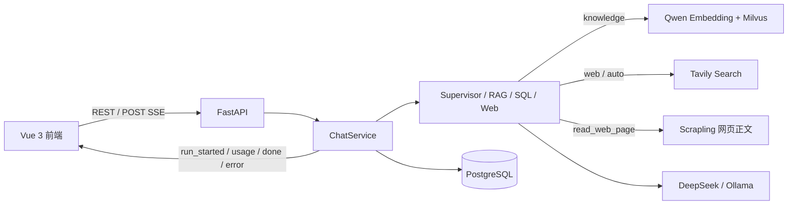

# Learning Q&A Assistant


一个面向多用户私有知识库的全栈 RAG Agent。系统将文档解析、向量检索、联网搜索、证据引用、模型降级、会话持久化和 SSE 事件流整合为一条可追踪、可测试的问答链路，而不是只演示一次模型调用。

## Supervisor 多 Agent（首期）

聊天入口现由 Supervisor 识别意图，委派 RAG、SQL、Web 三个专职 Agent，并统一汇总引用。
支持一次提问组合多个 Agent；子任务顺序执行，共享模型/工具预算与请求 deadline。

- `knowledge`：仅私有知识库；`sql`：仅业务只读 PostgreSQL；`web`：Tavily 搜索或 Scrapling 读网页；`auto`：自动组合。
- 在聊天框输入网页 URL 即可授权本轮读取（最多 3 个）。指定网页无需先搜索，未配置 Tavily 也可读取；搜索结果也可读取，正文链接不会自动授权。
- SQL 配置使用 `.env.example` 中的 `SQL_DATABASE_URL` 和 `SQL_ALLOWED_TABLES`；平台数据库不可作为业务数据源。数据源是所有已登录用户共享的获准业务数据集，只应授权他们均可查看的表；需要按用户限制时，应先增加业务授权层再开放。
- 新增 SSE `agent_started / agent_finished / agent_failed`；聊天中展示执行状态，最终 SQL 来源卡保留查询、返回行数与截断提示。历史消息复用相同格式。
- 每轮默认 16 次模型调用、12 次工具调用、最多 6 次委派、每个 Agent 最多 2 次；所有调用及降级共用预算。预算耗尽直接报错，不无限重试。

调用链、只读角色配置、测试与分阶段学习说明见 [多 Agent 实现指南](docs/multi-agent-guide.md)。

## 父子上下文检索

知识库问答默认先检索小块，再补充同一文档、页/章节/Sheet 内的相邻分组作为无编号理解上下文；引用仍只绑定实际命中的片段，Excel 行号不会被父块扩大。父块读取失败或超过预算时保留叶子并记录警告。复用既有索引，无需重建文档或新增 schema；可通过 `RETRIEVAL_PARENT_CONTEXT=false` 关闭。当前是两层实现，尚无三级自动合并，详见 [第三阶段说明](docs/parent-context-retrieval.md)。

## 可选 Rerank 精排

混合召回的候选先校验用户/文档权限、去重，再交给百炼文本排序 API，选出 Top K 后才扩展父块。默认关闭；在服务端配置 `RERANK_ENABLED / RERANK_ENDPOINT / RERANK_MODEL / RERANK_API_KEY` 后启用，不新增依赖或改变索引。引用中的 `score` 仍是 RRF 分数，新增 `rerank_score` 单独记录相关性分数。超时、服务错误和非法返回均沿用原排序，`run_metadata.rerank_events` 与 `warnings` 记录降级。配置、调用链及基线对比命令见 [第四阶段说明](docs/rerank-retrieval.md)。

## 项目亮点

可通过 `KNOWLEDGE_QUALITY_ENABLED=true` 启用第五阶段的知识库规划与证据判断：RAG 任务最多拆成两个独立检索问题，由 Grader 判断证据是否足以回答，整个请求最多一次针对缺失事实的改写补检索。未通过判断的候选不能作为最终引用；歧义返回澄清，资料不足返回不足说明。默认关闭，继续复用已有 Supervisor、Rerank、父块和 SSE 链路；详见[第五阶段说明](docs/knowledge-quality.md)。

第六阶段提供[答案与引用评估](docs/answer-evaluation.md)：默认离线读取答案和真实叶子证据快照，分别统计引用合法性、审阅主张忠实度、引用支持度及标准事实覆盖度；无语义审阅时保留 null。可显式调用现有 Supervisor 生成答案或调用现有模型作审阅，保存逐题结果、配置、指纹与同标注集的基线差值。仓库中的[合成样例报告](docs/evaluation/answer-smoke-report.json)含故意注入的错误，只验证评估器，不代表线上质量。

第七阶段加入[文档版本管理](docs/document-versions.md)：新版本使用独立文件、文档 ID、缓存和向量，旧版保留；就绪后在资料页的版本面板明确“设为当前”，默认问答只查当前版，指定旧版仍可查。历史引用保存版本号与内容哈希。先显式运行 `python -m app.bootstrap --document-versions` 添加两张表，再设置 `DOCUMENT_VERSIONS_ENABLED=true`；不会自动迁移或清理已有文件。

第八阶段提供[独立入库 Worker](docs/durable-ingestion.md)：复用 PostgreSQL 和原入库流程，任务与文档原子落库，支持跨进程领取、租约心跳、崩溃接管和有限重试。默认关闭；显式运行 `python -m app.bootstrap --ingestion-jobs` 后，在所有 API/Worker 设置 `INGESTION_MODE=durable`，并用 `python -m app.worker` 启动独立进程。所有进程需共享上传/缓存路径，不支持事务级连接池。

第九阶段加入 [Run/Event 持久化与 SSE 断线重放](docs/durable-chat-runs.md)：先保存事件，再发送给客户端；相同请求标识复用原 Run，重连按游标续传，最终助手消息与 done 事件原子提交。显式运行 `python -m app.bootstrap --chat-runs` 后设置 `CHAT_RUNS_ENABLED=true` 并重启 API。进程中断会标记错误，不自动重跑模型或工具；默认关闭，保留原流式入口。

- **Supervisor 多 Agent：** 可在 `knowledge / web / sql / auto` 四种模式下按策略选择 Milvus 私有知识库、Tavily 公网搜索，并按来源编号用 Scrapling 读取网页原文。
- **可验证的引用闭环：** 知识库与网页证据进入统一 Evidence Registry，连续编号、去重并校验最终引用；未知引用不会作为正常答案返回。
- **SSE 答案流已落地：** `POST /api/v2/sessions/{id}/messages/stream` 从真实模型 chunk 中增量提取 `answer`，持续推送回答正文、运行状态、用量、最终答案及错误；前端使用 `fetch + ReadableStream` 实时渲染临时消息。
- **可靠的文档入库：** PostgreSQL 状态机管理 `processing / ready / failed / deleting`，支持进程恢复、失败重试和删除补偿；PDF、Word、PowerPoint、旧版 XLS 通过 MinerU 解析；XLSX 本地按行处理并保留 Sheet/行号，TXT/Markdown 本地处理。
- **模型与外部服务容错：** DeepSeek 遇到连接、超时、429 或 5xx 时可有限降级至 Ollama；已完成的检索不会重复执行，鉴权错误不会被错误地重试或降级。
- **工程化交付：** FastAPI + Vue 3/TypeScript 前后端分离，采用应用服务、领域协议、仓储和基础设施适配器分层；提供显式初始化、结构化日志、request ID、能力发现与离线自动化测试。

## 技术栈

| 层级 | 技术 |
| --- | --- |
| 前端 | Vue 3、TypeScript、Pinia、Vue Router、Vite |
| API / Agent | FastAPI、Pydantic、LangChain、DeepSeek、Ollama |
| 检索 | Milvus、Qwen Embedding、Tavily Search、Scrapling |
| 数据与任务状态 | PostgreSQL、SQLAlchemy |
| 文档解析 | MinerU、openpyxl、PyPDF、python-docx、LibreOffice |
| 可观测与传输 | SSE、结构化日志、request ID、LangSmith（可选） |

## 核心链路



代码学习请看 `docs/code-guide.md`：包含分层架构、依赖注入详解、上传/问答调用链和后续修改入口。

V2 架构与安全边界见 [RAG Agent V2 详细架构设计](docs/rag-agent-v2-architecture.md)。

V3 实现依据见 [Vue 前端架构与后端接入方案](docs/rag-v3-frontend-architecture.md)：包含界面、组件与状态划分、文件夹上传、用量展示和后端契约。

## 1. 当前实现

- FastAPI 文档与会话 API、JWT 登录、可轮换 Refresh Token、用户作用域查询、统一错误与 request_id。
- 本地 TXT/Markdown、文本型 PDF、DOCX 解析；旧 DOC 通过 LibreOffice 转换。
- 可配置 token 切片、确定性 chunk ID、千问批量 Embedding、Milvus Dense + 原生 BM25 混合检索。
- PostgreSQL 元数据和消息持久化，文档状态机、重试与删除补偿。
- 最近消息上下文、服务端引用、DeepSeek/Ollama 回答与 SSE 增量答案。
- DeepSeek 可重试错误发生时，可显式开启一次 Ollama 降级；鉴权错误不降级。
- LangSmith 对 LangChain 模型调用的追踪配置；默认隐藏输入/输出。
- `knowledge / web / sql / auto` 四种模式、请求内证据登记、混合引用和有限工具循环。
- Tavily 固定公开搜索词；Web Agent 可按本轮授权 URL 调用 Scrapling 读取清洗后的网页正文，网络结果不会写入 Milvus。
- XLSX 本地表格感知解析与精确行引用；PDF、Word、PowerPoint、XLS 显式启用后经 MinerU 云解析；TXT/Markdown 本地解析。
- 会话持久化、运行元数据和显式数据库初始化。

**仍未实现：** SSE 断线续传、自动滚动摘要、持久任务队列、多 worker 和网页自动入库。

## 2. 项目结构

```text
app/
  api/                        HTTP 路由、请求/响应模型、依赖与请求体限制
  application/
    container.py              服务装配与就绪检查
    ingestion.py              文档入库、失败重试、删除
    sessions.py               会话 CRUD 与单进程并发控制
    chat.py                   消息保存与问答用例
    evidence.py               来源编号、去重和引用校验
    retriever.py              知识库检索
  domain/contracts.py         Chunk、SearchHit、模型/向量库协议
  infrastructure/
    persistence/              SQLAlchemy 模型、仓储与 PostgreSQL 连接
    vectorstores/milvus.py     Milvus schema、用户过滤、向量读写
    embeddings/qwen.py        千问兼容接口
    llms/providers.py         LangChain 模型适配、选择与有限降级
    loaders/local.py          本地解析与共享切片
    loaders/excel.py          XLSX 行语义、物理行号与稳定来源锚点
    loaders/mineru.py         MinerU 签名上传、轮询、下载和结构归一化
    search/tavily.py          Tavily 搜索适配与结果安全过滤
    search/scrapling.py       已登记搜索来源的网页正文抓取与安全校验
  workflows/supervisor.py     Supervisor 与 RAG/SQL/Web 子 Agent
  workflows/agent.py          共享模型预算、降级及答案增量解析
  core/                       环境配置、异常与结构化日志
  bootstrap.py                显式初始化存储
  main.py                     FastAPI 入口
```

根目录 `main.py` 和 `scau/agentdemo.py` 保留为原始实验脚本。**新服务从 `app.main:app` 启动**，不会执行实验脚本的 Milvus 初始化。

`frontend/` 是 Vue 3 + TypeScript 前端。开发时先启动 FastAPI，再执行 `cd frontend`、`npm install`、`npm run dev`；Vite 会把 `/api` 和 `/health` 代理到 `127.0.0.1:8000`。生产构建使用 `npm run build`。

## 3. 安装和配置（Windows PowerShell）

工作目录为本项目根目录，Python 3.12+。依赖已经声明在 `pyproject.toml` 并锁定在 `uv.lock`。

```powershell
# 如果没有 uv，先在虚拟环境之外安装它
python -m pip install uv
uv sync --locked
```

保留现有 `.env`，只参考 `.env` 补充缺少的项，不要覆盖已有密钥。配置文件按项目根目录定位，不依赖当前终端所在位置。环境变量优先于 `.env`；`DATABASE_URL` 优先于 `DB_URL`。

### PostgreSQL

云端连接默认要求 TLS：URL 使用 `sslmode=require`，正式部署推荐配置证书并使用 `verify-full`。当前如果 URL 中是 `sslmode=disable`，业务接口和 readiness 会返回 `DATABASE_TLS_REQUIRED`，但 `/docs` 和存活接口仍可打开。不会偷偷覆盖 URL。

只有在确认开发环境受信任、并明确接受明文连接风险时，才在当前终端显式临时关闭此限制：

```powershell
$env:DATABASE_REQUIRE_TLS = 'false'
```

这只取消应用的 TLS 校验，实际连接方式仍由原 URL 的 sslmode 控制；不要把这个设置用于公网部署。

### JWT 与注册

必须配置至少 32 字节的 `JWT_SECRET`。可用 `python -c "import secrets; print(secrets.token_hex(32))"` 生成。Access JWT 默认 15 分钟并只保存在前端内存；30 天 Refresh Token 是 HttpOnly Cookie 中的随机 opaque token，数据库只保存哈希并在每次刷新时轮换。

本地开发设置 `REGISTRATION_ENABLED=true`、`AUTH_COOKIE_SECURE=false`；HTTPS 部署必须恢复 `AUTH_COOKIE_SECURE=true`。`FRONTEND_ORIGIN` 必须是实际前端 origin，用于刷新接口的 CSRF 来源校验。

### Milvus 和 Embedding

默认连接本机 `http://localhost:19530`，数据库 `rag_tutorial`，混合集合 `rag_docs_hybrid_v1_1024`。需要支持原生 BM25 的 Milvus 2.5+，建议至少 2.5.11；请先启动可访问的 Milvus，或配置 `MILVUS_URI`、`MILVUS_TOKEN`。本项目不自动安装或启动 Milvus。

默认选择文本模型 `text-embedding-v4`、1024 维、每批最多 10 条，不沿用实验脚本中的 `qwen3-vl-embedding`。默认 DashScope 地址是北京地域的文本 Embedding 兼容接口；密钥所属地域不同需要同时调整 `DASHSCOPE_BASE_URL`。多模态接口不是本轮适配范围。

集合同时保存 Qwen 稠密向量和由中文 Analyzer 生成的 BM25 稀疏向量，检索时使用 RRF 融合；返回的知识库 `score` 是 RRF 分数，不再是 COSINE 分数。集合描述记录模型、维度和检索架构签名，读写时校验。切换模型、维度或从旧 Dense 集合升级时必须换新集合并重新入库；旧文档迁移工具暂未实现。请在第一次上传前确认模型配置。

### Ollama

默认地址 `http://localhost:11434`；`OLLAMA_MODEL` 必须填写已安装模型的精确名称，可通过 `ollama list` 查看。默认 `qwen3.5:9b` 不会自动下载。设置 `ALLOW_MODEL_FALLBACK=true` 后，DeepSeek 遇到连接、超时、429 或 5xx 时只重试当前模型步骤并切换一次 Ollama；已完成的检索和 Tavily 请求不会重跑。

### LangSmith

官方 US 默认端点为 `https://api.smith.langchain.com`，注意 `.com` 不能写成 `.co`。为避免向拼错的域名发送 API Key，非预设官方 HTTPS 域名会禁用追踪，并记录 `langsmith_disabled_untrusted_endpoint`；不影响问答本身。只有确认是自己的 HTTPS 私有部署，才设置 `LANGSMITH_ALLOW_CUSTOM_ENDPOINT=true`。

默认 `LANGSMITH_HIDE_INPUTS=true`、`LANGSMITH_HIDE_OUTPUTS=true`，不上传完整问题/检索正文/回答；追踪仍可能包含模型名和调用元数据。不开启完整正文追踪，除非确认资料可发送到该平台。

### XLSX 精确行引用

新 `.xlsx` 默认在本地按行解析，保留表头、单位、Sheet 与真实物理行号，无需 MinerU。支持多 Sheet、空行与长行拆片；首版要求第一行是单层表头，不支持合并单元格。既有 Milvus 集合需先显式执行 `python -m app.bootstrap --excel-provenance` 添加可空 JSON 字段，命令要求服务端支持字段追加（目标 Milvus 2.6+），不会删除数据。旧文档保持可查，旧 XLSX 不自动重建。详见 [第二阶段实现与升级说明](docs/excel-row-citations.md)。

### MinerU 与 Office/PDF

设置 `MINERU_ENABLED=true` 并配置 `MINERU_API_TOKEN` 后，新 PDF、DOC/DOCX、PPT/PPTX、XLS 会上传到 MinerU 云端解析；未显式启用时这些格式在创建数据库记录前返回 503。上传前会校验 PDF/OLE/OOXML 容器，解析超时后可沿用已有 `batch_id`，Embedding 重试复用本地规范化缓存；进程重启会恢复 processing 文档，若上次停在上传阶段则创建新的安全批次。TXT/MD 使用 UTF-8 且不会上传到 MinerU。`INGESTION_WORKERS` 默认 2，用于限制本进程同时处理的文档数。

### Tavily 与 Scrapling

设置 `WEB_SEARCH_ENABLED=true` 并配置 `TAVILY_API_KEY` 后，`web` 和 `auto` 模式可调用网络搜索。联网时只发送当前问题或显式 `web_query`，不会发送历史消息或知识库片段。应用会阻止明显的密钥、连接串和超长公开查询，但这不是完整的隐私识别；发送前仍需确认查询可公开。

`web` 模式下，Web Agent 可继续调用 `read_web_page(url)`，用 Scrapling 读取本轮 Tavily 已登记来源的正文。该工具仅接受本轮用户指定、搜索返回或服务端配置的 URL，且会限制公网 DNS、端口、重定向、响应类型、2 MiB 响应体、超时和送入模型的字符数。可通过 `SCRAPLING_TIMEOUT` 与 `SCRAPLING_MAX_CHARACTERS` 调整后两项；当前只使用静态 HTTP Fetcher，不需要下载浏览器运行时。

## 4. 初始化与启动

应用启动**不会**自动创建云端表或 Milvus 集合。确认数据库和向量库配置后，显式执行：

```powershell
.venv/Scripts/python.exe -m app.bootstrap --postgres
.venv/Scripts/python.exe -m app.bootstrap --milvus
.venv/Scripts/python.exe -m uvicorn app.main:app --host 127.0.0.1 --port 8000 --reload
```

PostgreSQL 表位于独立的 `rag` schema；初始化使用当前 ORM 定义创建完整结构。

- 交互式接口文档：`http://127.0.0.1:8000/docs`
- 存活：`GET /health/live`，不连接外部服务。
- 就绪：`GET /health/ready`，检查表、Milvus 集合兼容性和必要模型配置，不调用收费模型。

当前仅支持单进程开发部署，不要启用多个 Web worker。后台入库有持久状态和启动恢复，但执行器仍在应用进程内；需要横向扩容时再增加数据库任务租约。

本次认证模型修改了已有表结构，`create_all` 不会迁移旧表。开发库按约定需要在人工确认后清空 `rag` schema、文档/记忆 Milvus 集合及 `data/uploads`、`data/parsed`，再重新执行两个 bootstrap 命令；应用启动不会自动删除任何数据。

## 5. 最小联调

业务接口均要求登录返回的 Bearer Access JWT。当前用户只从已验证 JWT 中取得，客户端不能指定用户 ID。两个用户的相同文件允许分别上传；同一用户重复内容返回 409。

```powershell
$login = Invoke-RestMethod http://127.0.0.1:8000/api/v2/auth/login -Method Post `
  -ContentType 'application/json' -Body '{"username":"alice","password":"correct horse battery"}'
$headers = @{ Authorization = "Bearer $($login.access_token)" }

# 上传已有本地文件；Windows 请使用 curl.exe 而非 PowerShell 的 curl 别名
curl.exe -X POST http://127.0.0.1:8000/api/v2/documents `
  -H "Authorization: Bearer $($login.access_token)" -F 'file=@knowledge.txt'

# 保存上传响应中的文档 ID，轮询到 ready 后再问答
$documentId = '替换为上传返回的文档UUID'
Invoke-RestMethod "http://127.0.0.1:8000/api/v2/documents/$documentId" -Headers $headers

$session = Invoke-RestMethod http://127.0.0.1:8000/api/v2/sessions `
  -Method Post -Headers $headers -ContentType 'application/json; charset=utf-8' `
  -Body ([System.Text.Encoding]::UTF8.GetBytes('{"title":"学习助手"}'))

$body = @{ question = '这份资料主要讲什么？'; search_mode = 'knowledge'; document_ids = @($documentId); model_provider = 'deepseek' } | ConvertTo-Json
Invoke-RestMethod "http://127.0.0.1:8000/api/v2/sessions/$($session.id)/messages" `
  -Method Post -Headers $headers -ContentType 'application/json; charset=utf-8' `
  -Body ([System.Text.Encoding]::UTF8.GetBytes($body))
```

未传 `document_ids` 时使用当前用户全部 ready、且模型匹配的文档；传入空列表会被拒绝，避免误当作全库查询。

## 6. API 与错误

| 方法 | 路径 | 行为 |
| --- | --- | --- |
| POST/GET | `/api/v2/documents` | 上传，或按名称和状态分页查询 |
| GET/DELETE | `/api/v2/documents/{id}` | 查询详情或删除文档 |
| POST | `/api/v2/documents/{id}/retry` | 重试失败或中断的文档 |
| GET | `/api/v2/documents/{id}/processing` | 查看解析阶段，不暴露上游任务 ID |
| POST/GET | `/api/v2/sessions` | 创建或列出会话 |
| GET/DELETE | `/api/v2/sessions/{id}` | 读取或删除会话 |
| POST | `/api/v2/sessions/{id}/messages` | Agent 非流式问答 |
| POST | `/api/v2/sessions/{id}/messages/stream` | SSE 增量输出回答、运行状态、用量与已校验的最终结果 |

### SSE 事件流（已实现）

由于问答请求需要 POST body 和 Bearer Token，前端不使用仅支持 GET 的 `EventSource`，而是通过 `fetch` 读取 `ReadableStream`。服务端设置 `text/event-stream`、`Cache-Control: no-cache, no-transform` 和 `X-Accel-Buffering: no`，避免常见代理缓冲。

| 事件 | 说明 |
| --- | --- |
| `run_started` | 返回 `run_id`、请求 ID、搜索模式，确认服务端已开始处理 |
| `answer_start` | 开始一版临时回答；补检索、修复或模型降级产生新版本时，前端清空旧临时内容 |
| `answer_delta` | 从模型结构化输出中安全提取的回答增量；前端实时追加到临时 assistant 消息 |
| `context_usage` | 可选；返回本轮模型上下文占用信息 |
| `usage` | 返回 token 用量和上游报告的 cache 指标 |
| `done` | 引用校验及数据库提交成功后，返回权威 `message_id`、完整答案、引用和运行元数据 |
| `error` | 流启动后的业务或服务错误，携带错误码、HTTP 语义状态和 request ID |

```powershell
curl.exe -N -X POST "http://127.0.0.1:8000/api/v2/sessions/<session-id>/messages/stream" `
  -H "Authorization: Bearer $($login.access_token)" `
  -H "Accept: text/event-stream" `
  -H "Content-Type: application/json" `
  -d '{"question":"总结当前资料","search_mode":"auto","model_provider":"deepseek"}'
```

Agent 的模型输出是可能经历工具调用和修复的结构化 JSON。服务端增量解析其中的 `answer` 字段，只发送回答正文，不泄露工具调用、JSON 包装或内部推理。流式正文属于临时显示：补检索、修复或模型降级会用新的 `answer_start` 重置它；引用校验和持久化成功后，前端再用 `done` 中的权威答案覆盖。异常时重新读取会话，避免“服务端已落库但浏览器未显示”的假失败。

请求示例：

```json
{
  "question": "结合我的资料和最新公开信息回答",
  "search_mode": "auto",
  "document_ids": ["文档UUID"],
  "web_query": "可选的公开搜索词",
  "model_provider": "deepseek"
}
```

`knowledge/sql` 禁止联网参数；`web/sql` 禁止 `document_ids`；`auto` 可以组合 RAG、SQL 与 Web。网页引用与知识库引用使用同一连续编号。

资源不存在与越权访问均返回 404。忙碌资源返回 409。响应不暴露原文件路径、凭据或上游原始错误：

```json
{"error":{"code":"DOCUMENT_NOT_READY","message":"指定文档尚未就绪","request_id":"..."}}
```

## 7. 一致性与当前限制

- 入库前提交 processing；锁定文档行，清理旧向量，再分批 Embedding/upsert；全部成功才 ready。失败清理是尽力执行，清理失败时由下次重试继续，failed 文档不会被检索。
- 进程退出可能留下 processing；确认原任务已停止后调用 retry。正在运行的任务持有数据库行锁，重试/删除返回 409。重复后台任务遇到 ready 会跳过。
- 删除先提交 deleting，向量或文件清理失败时保留记录，重复 DELETE 可继续。完全删除后再次 DELETE 返回 404，不承诺重复请求仍为 204。
- 会话问题先落库；只有完整成功才保存 assistant。生成失败时仅保留用户问题。消息原文一直保留至会话被删除；运行时只读取最近 N 条。
- summary/summarized_through 字段已存在并可被读取，但本轮不自动生成或推进摘要。token_usage 是最终答案调用的用量，不包含查询改写等整次请求总用量。
- 引用只来自本次召回且在答案中被引用的编号；未知编号直接报错。该校验不等价于回答事实正确；答案/引用评估工具已提供，真实语料和在线效果仍需独立验证。
- 检索目前仅去除完全重复正文，没有语义重排或近似重叠去重。
- 每个会话使用独立的进程内锁控制并发，不同会话可并行处理。多 worker 需要改为数据库级会话串行机制。
- 本地解析具备文件/解压大小、页数、文本量、切片数量限制；DOC 有子进程超时，但 PDF/DOCX 解析尚未放进隔离进程。对外服务前仍须补解析沙箱和网关级速率限制。
- 当前没有迁移旧集合、孤儿文件自动回收和多 worker 持久任务协调；单 worker 可通过本地规范化缓存和已有 MinerU `batch_id` 显式 retry 恢复。

## 8. 本轮验证与密钥安全

离线测试使用 SQLite、脚本化 LangChain 模型和 HTTP 替身，覆盖 API 路由、用户隔离、引用、Tavily 边界、MinerU 四类归一化、批次恢复、模型单步降级和 Agent 输出修复。`tests/fixtures/rag_v2_cases.json` 保存 30 题固定质量集。

2026-09-20 已实测 PostgreSQL 行锁、用户隔离、Milvus 用户过滤，以及真实 Qwen Embedding、DeepSeek knowledge 问答和 Tavily web 问答。MinerU 结果下载会重试临时网络故障；Windows 上 Python/OpenSSL 与结果 CDN 握手不兼容时，会使用系统 `curl.exe` 的 Schannel 安全下载，仍然校验证书并限制结果大小。

基础检查：

```powershell
.venv/Scripts/python.exe -m unittest discover -s tests -p 'test_*.py' -v
$env:RUN_STORAGE_INTEGRATION='1'
.venv/Scripts/python.exe -m unittest tests.integration.test_storage_v2 -v
.venv/Scripts/python.exe -m compileall -q app tests
.venv/Scripts/python.exe -m pip check
```

`.gitignore` 已排除 `.env`、本地运行日志和上传目录。复制 `.env.example` 为 `.env` 后再填写本机凭据；不要提交真实密钥。已经公开或粘贴到不可信位置的凭据建议轮换。

## 9. 后续范围

后续按需增加 SSE 断线恢复、事务式滚动摘要、密码找回、可靠任务队列、多 worker 协调和网页自动入库。

## 10. 检索召回率评估

先准备 JSON 评估集。每道题必须人工标注相关切片；没有相关切片标注时，无法计算召回率：

```json
[
  {
    "id": "q01",
    "user_id": "用户 UUID",
    "question": "服务器维护负责人是谁？",
    "document_ids": ["文档 UUID"],
    "relevant_chunk_ids": ["正确答案所在切片 UUID"]
  }
]
```

运行真实的 Embedding + Milvus 检索链路：

```powershell
.venv/Scripts/python.exe -m scripts.evaluate_retrieval retrieval-eval.json
```

输出包括宏平均 `recall@1/3/6`、`hit_rate@1/3/6` 和 `mrr`。评估集应覆盖真实问题、同义改写、跨段问题和无答案问题；无答案问题应另算误召回率，不要混入 Recall 的分母。
