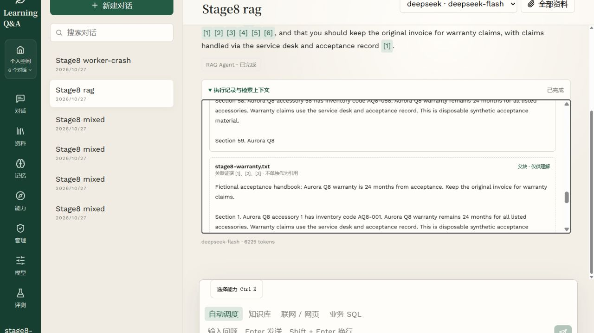

# Learning Q&A Assistant

**面向个人与团队知识库的全栈 RAG Agent：可追溯问答、可恢复任务与用户可控的跨会话记忆。**


将分散的文档、表格和获准外部来源接入同一问答流程，让用户能够核对答案出处、查看执行过程，并在中断后继续处理任务。项目覆盖 Vue 前端、FastAPI 接口、PostgreSQL 持久化、Milvus 混合检索、独立 Worker 和 OpenViking 自动记忆。

**当前状态：核心功能已实现，架构检查通过；记忆稳定性、延迟及 RAG 质量门禁尚未全部通过。** 自动记忆默认关闭，生产启用需要显式迁移、服务配置与用户同意。

[实测与逐题记录](docs/validation/memory-live-20261029/report.md) · [架构验收](docs/validation/architecture-openviking-acceptance.md) · [部署指南](docs/deployment-preflight.md) · [功能演进记录](docs/replication-repair-progress.md)

## 已验证的结果

以下为 **2026-10-29～30、本项目隔离测试环境**的测量结果。记忆实验使用 100 个冻结合成场景，每组重复 3 次；语义标签由固定模型评审，尚无完整人工复核。

| 指标 | 基线 → 当前 | 解释与验收状态 |
| --- | --- | --- |
| Web 直接依赖持久化的文件 | **1 → 0** | 静态检查通过 |
| Service 直接导入 SQLAlchemy | **0** | 原 application 中 20 个相关文件的操作已下沉或重新分层，两个目录口径不等同 |
| 禁止方向依赖 / 循环依赖 | **0 / 0** | 169 个规范模块、76 个兼容入口 |
| 跨会话回答正确率 | **60.00% → 99.67%** | 提升 **39.67 个百分点**；每组 300 次尝试，自动组 1 次执行失败计 0 |
| 更正后新事实采用率 | **0% → 100%** | 每组 60 次更正场景 |
| 跨用户泄漏 / 单条删除后召回 | **0 / 0** | 100 个随机 canary 检查全部完成；复用 8 对隔离账号 |
| 成功回答 P95 | **4.97 秒 → 5.93 秒** | **+19.3%，未达到 ≤10% 目标**；自动组仅 299 个成功回答，完整口径 P95 不可用 |
| 同事实受控 Recall@3 | **99.44% → 99.44%** | 180 次、1 次失败；OpenViking 使用 `vectors_only`，未证明检索质量提升 |
| 原 80 题 RAG 回归 | **69 成功 / 11 失败** | 原质量门禁未通过；10 次 `INVALID_CITATION`、1 次 `AGENT_LIMIT_EXCEEDED` |

**尝试历史完整保留。** 原冻结实验的 600 次尝试中，274 次受模型余额耗尽影响而失败。补充额度后保留已完成的第一轮，并另存第二、三轮全部配对场景的 400 次新尝试，形成上表的恢复测量；原失败没有被覆盖或剔除。自动组的另 1 次失败源于冻结的 2048 Token 提取输出上限。

这些结果说明自动采集对本合成集的跨会话回答有帮助，不能外推为生产准确率。回答、准备会话、任务内提取与 Embedding 的已报告用量分别记录；任务外查询 Embedding、失败调用和维护账单仍不完整，**不宣称总 Token 或费用下降**。见[实验方法与置信区间](evals/memory/README.md)、[阶段用量](docs/validation/memory-live-20261029/phase-usage.json)。

## 工程实现

| 问题 | 实现 | 可核对的入口 |
| --- | --- | --- |
| 答案需要可追溯的依据 | Dense + BM25 混合召回、RRF、父子上下文；XLSX 保留 Sheet 和物理行号，引用绑定实际叶子证据 | [表格引用](docs/excel-row-citations.md)、[上下文检索](docs/parent-context-retrieval.md) |
| 一个问题可能需要多个数据源 | Supervisor 顺序委派 RAG、只读 SQL、Web Agent，共享调用次数、工具次数和 deadline；Rerank、规划与 Grader 可选启用 | [多 Agent 调用链](docs/multi-agent-guide.md)、[证据判断](docs/knowledge-quality.md) |
| 请求和进程会中断 | PostgreSQL 持久任务、租约、fencing、幂等键和检查点；事件先落库，再经 SSE 输出，重连按游标重放 | [持久 Run 执行](docs/durable-run-execution.md)、[SSE 重放](docs/durable-chat-runs.md) |
| 多用户和团队资料需要隔离 | JWT / Refresh Token 轮换、用户作用域查询、组织角色、团队空间和版本发布；保存答案前复核范围 | [组织共享](docs/organization-sharing.md)、[索引发布](docs/index-adoption.md) |
| 个性化记忆需要可控 | 手工记忆保留；用户开启后异步提取偏好和稳定事实，支持查看、删除、清空、关闭；代际与墓碑阻止旧任务恢复已删除内容 | [OpenViking 数据流与删除语义](docs/openviking-memory.md) |
| 工具调用需要边界和审计 | 版本化 Skill / Tool 目录、Run 绑定审批、独立 Sandbox、产物和运行追踪；未知副作用结果不盲目重放 | [能力中心](docs/capability-center.md)、[审批与沙箱](docs/approval-sandbox-plan.md) |
| 模型效果需要可复核 | 不可变数据集、证据快照、预测摘要绑定评审、逐题 JSON、独立评测 Worker；区分执行完成、评分覆盖与质量门禁 | [评测工作台](docs/evaluation-workbench.md)、[答案与引用评估](docs/answer-evaluation.md) |

SQL Agent 仅连接单独配置的业务只读数据库和显式表白名单；平台数据库不作为业务数据源。Web 读取限定在本轮获准来源。文档云解析、网络搜索、模型降级、自动记忆等能力按配置显式开启。

## 分层架构

```text
frontend/                  Vue 3 + TypeScript：页面、交互、SSE 与运行追踪
app/
  open_api/                对外 HTTP / SSE 契约的发布入口
  web/                     路由、认证上下文、参数校验与响应
  service/                 业务规则、权限决策、流程与事务边界
    agent/                 Supervisor / RAG 业务编排
  manager/                 可复用能力、第三方服务与模型适配
    openviking.py          OpenViking HTTP 适配与可信身份
  dao/                     PostgreSQL、Milvus 与持久化查询
  entity/                  DO / DTO / BO / Query / VO
  composition/             依赖装配与资源生命周期
  core/                    配置、异常、日志及通用工具
  main.py                  FastAPI 入口
  *_worker.py              入库、Run、评测和记忆等独立进程
```

请求经 Web 进入 Service；Service 可调用 Manager 或直接调用 DAO。Entity 是模型集合，不是额外的执行步骤。开放接口层与 Web 共同形成同一 HTTP 接口，不增加重复转发。

- Web 不直接访问 ORM、向量库或模型 SDK；SQL 构造和执行集中在 DAO。
- Service 决定事务边界，网络请求和模型推理保持在数据库长事务之外。
- 自动记忆由独立 Worker 提交和跟踪；提取尚未完成时不显示“已记住”，服务不可用时保留原问答能力。
- 旧导入通过兼容入口转发到唯一实现，保留原 HTTP path / schema、SSE、幂等和恢复行为。

分层采用[阿里巴巴规约中适用于本 Python 项目的工程职责](docs/layered-architecture.md)，不宣称通过 Java P3C 或整本 Java 手册认证。

## 界面与两分钟演示

实际界面中的引用叶子与父级上下文，使用合成验收材料：



环境准备完成后，可按以下路线演示：

1. 登录并上传一份 TXT / Markdown 或 XLSX，查看处理状态直到 `ready`。
2. 在知识库模式提问，观察 SSE 回答，再打开引用，核对文档片段或表格物理行。
3. 展开执行记录，查看 Agent、检索、工具调用和用量；完整配置下可演示审批与持久 Run 恢复。
4. 配好 OpenViking 后在“长期记忆”中主动开启，提供一条稳定偏好；等待后台提取完成，再在新会话提问，并演示删除。

截图来自已有功能验收，不代表自动记忆、RAG 或延迟门禁全部通过。仓库未提供常驻公网演示地址。

## 快速启动

以下是 Windows PowerShell 的本地开发流程。需要 Python 3.12+、uv、Node.js 22.18+，以及可连接的 PostgreSQL 和支持原生 BM25 的 Milvus。

```powershell
git clone https://github.com/Yu050318/learning-qa-assistant.git
cd learning-qa-assistant
uv sync --locked

# 已有配置保留；仅在不存在时创建副本
if (-not (Test-Path -LiteralPath '.env')) {
    Copy-Item -LiteralPath '.env.example' -Destination '.env'
}
```

编辑 `.env`，至少完成以下配置：

| 配置 | 用途 |
| --- | --- |
| `DATABASE_URL` | PostgreSQL 连接；默认要求 TLS，公网部署应验证证书 |
| `JWT_SECRET` | 至少 32 字节；可用 `python -c "import secrets; print(secrets.token_hex(32))"` 生成 |
| `DASHSCOPE_API_KEY` | 文本 Embedding；模型、维度和供应商地域需匹配 |
| `DEEPSEEK_API_KEY` / `DEEPSEEK_MODEL` | 问答模型；模板使用 `deepseek-flash` |
| `MILVUS_URI` / `MILVUS_DATABASE` / `MILVUS_COLLECTION` | 向量库位置及集合；示例采用 1024 维 Embedding |
| `FRONTEND_ORIGIN` / `AUTH_COOKIE_SECURE` | 刷新令牌的来源与 Cookie 配置；HTTPS 部署启用 Secure Cookie |

仅在受信任的本地明文数据库上，才显式设置 `DATABASE_REQUIRE_TLS=false`。模型/Embedding 密钥、`.env`、上传文件、原始日志和私人材料不应提交到 Git。

```powershell
# 显式迁移；应用启动不会自动修改数据库
uv run python -m app.migrate

# 新环境初始化 Milvus；已有集合先核对模型、维度与来源字段兼容性
uv run python -m app.bootstrap --milvus

# 启动后端
uv run uvicorn app.main:app --host 127.0.0.1 --port 8000 --reload
```

另开终端启动前端：

```powershell
cd frontend
npm ci
npm run dev
```

- 前端：`http://localhost:5173`；开发代理将 `/api`、`/health` 转发至后端。
- API 文档：`http://127.0.0.1:8000/docs`。
- 健康检查：`/health/live` 检查进程；`/health/ready` 检查服务配置及依赖就绪，不调用收费模型。
- 新账号注册由 `REGISTRATION_ENABLED` 控制，平台管理员通过[邀请码流程](docs/platform-administration.md)创建。

以上为默认开发配置。已有数据库先备份并执行迁移，保留原有数据，不通过清空 schema 或重建集合升级。持久任务、模型中心和团队空间启用时，按[部署预检](docs/deployment-preflight.md)配置所有 API / Worker；不要只开启开关却遗漏独立进程。

OpenViking 需按[接入说明](docs/openviking-memory.md)配置独立服务、网关和供应商，再启动 `uv run python -m app.memory_worker`。用户仍须主动开启；不采集团队会话、评测答案、工具输出或模型回答，不启用任务经验学习。

## 验证与复现

最近一次记录：后端全量 **798 passed、55 skipped、38 subtests passed**；随后评测保护相关 **8 项测试通过**。独立 PostgreSQL 的 3 项自动记忆集成测试及前端类型检查 / 构建通过。跳过项需要各自的外部服务环境，不计作通过；这些记录不能代替真实模型质量验收。

```powershell
# 分层方向、循环依赖和兼容入口检查
uv run python scripts/check_architecture.py

# 测试工具单独提供，运行时依赖仍以 uv.lock 为准
uv run --with pytest==9.1.1 python -m pytest -q

# 校验固定 RAG 资产；仅 manifest 白名单中的 12 个文件可入库
uv run python scripts/verify_enterprise_fixture.py

# 重算已交付的记忆测量，不调用收费模型
uv run python scripts/evaluate_memory.py --predictions docs/validation/memory-live-20261029/recovered/predictions.json --reviews docs/validation/memory-live-20261029/recovered/reviews.json --isolation docs/validation/memory-live-20261029/isolation.json --output tmp/memory-rescored
```

前端校验：在 `frontend/` 执行 `npm run test:agents` 与 `npm run build`。真实模型实验会产生费用，并重置专用测试账号的记忆；运行前使用独立环境，按[评测说明](evals/memory/README.md)准备账号与授权。

## 复盘与下一步

| 取舍或发现 | 当前处理与后续工作 |
| --- | --- |
| 自动记忆提高本固定集的跨会话回答正确率，但增加提取调用和召回耗时 | 异步提取不阻塞当前回答；继续优化召回延迟，重新验证 ≤10% 的 P95 目标 |
| 提取输出触及 2048 Token 上限 | 明确失败，不发布未完成记忆；调整预算或提取配置后建立新的实验记录，保留旧失败 |
| 80 题 RAG 回归存在引用和调用预算失败，部分语义指标也未达原阈值 | 修复无答案场景的引用处理和预算耗尽问题，再按原门禁完整回归 |
| 未获得完整账单，语义标签尚无完整人工复核 | 继续补齐用量覆盖和人工抽查，不将未知成本当零，也不将合成集结果当生产保证 |

## 文档索引

| 主题 | 文档 |
| --- | --- |
| 架构与职责 | [分层及规约适用清单](docs/layered-architecture.md)、[V2 设计](docs/rag-agent-v2-architecture.md)、[Vue 接入](docs/rag-v3-frontend-architecture.md) |
| 检索与解析 | [XLSX 行引用](docs/excel-row-citations.md)、[父子上下文](docs/parent-context-retrieval.md)、[三级分块](docs/hierarchical-retrieval.md)、[Rerank](docs/rerank-retrieval.md) |
| 任务与协作 | [入库 Worker](docs/durable-ingestion.md)、[Run 恢复](docs/durable-run-execution.md)、[版本管理](docs/document-versions.md)、[组织共享](docs/organization-sharing.md) |
| 记忆与评测 | [OpenViking](docs/openviking-memory.md)、[记忆语料与方法](evals/memory/README.md)、[实测报告](docs/validation/memory-live-20261029/report.md)、[RAG 语料](evals/rag/synthetic_enterprise/README.md) |
| 部署与历史 | [部署预检](docs/deployment-preflight.md)、[Docker](docs/docker-deployment.md)、[平台管理](docs/platform-administration.md)、[阶段记录](docs/replication-repair-progress.md) |
