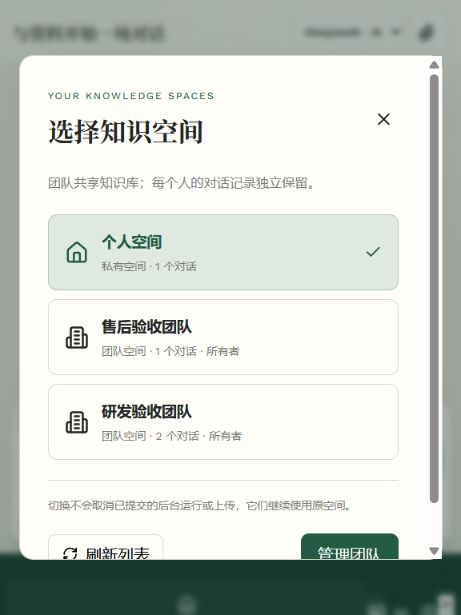
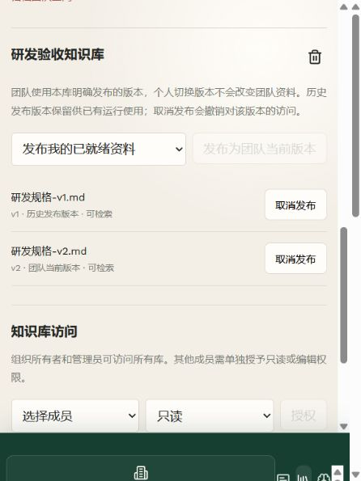

# 阶段六最终验收

2026-10-20。范围为知识空间、冻结检索索引、候选核验/发布、版本退休和持久文档任务。功能源码与本报告在同一阶段提交；不以本阶段验收宣称阶段七至九完成。

## 验证结果

| 验证 | 结果和边界 |
| --- | --- |
| 后端离线全量 | 557 passed、45 skipped、38 subtests passed；跳过的真实存储测试另行执行 |
| PostgreSQL 迁移及 Milvus 旧索引接管 | 30 passed，包含五个兼容初始化入口及两个真实双存储测试；临时数据库/集合独立于业务数据 |
| 前端 | 构建及 25 项 Node 测试通过；更新锁文件中的 DOMPurify/source-map-js 后 npm audit 为 0 |
| Docker 完整部署 | 实际构建 API、前端及三个独立 Worker；真实 PostgreSQL/Milvus/Qwen Embedding，虚构资料和测试账号；预检通过 |
| Docker 旧索引接管 | 未绑定时预检拒绝；只读完整核验后显式绑定成功，再执行返回 already_bound；原叶子和文件保持一致 |
| 业务部署 | 备份并实际恢复验证项目数据库和四份源文件/解析缓存；迁移至 0008，完整核验两份历史 PDF 的 925 个原叶子并绑定；仅启用发布和空间两项开关；API/前端 HTTP 200，三个 Worker 预检通过 |

独立预检/接管/评测组合另有 50 项通过；最终全量包含对应离线回归。原始测试 XML 保存在忽略目录 `data/validation/stage6-*.xml`。已追踪的部署证据为 [业务数据保留及预检](stage6-deployment.json)、[Docker 旧索引接管](stage6-docker-adoption.json)、[Docker 功能验证](stage6-docker-acceptance.json)。证据不包含业务凭据或业务原文。

## 完整流程

- 空间列表展示个人和当前账号有效团队，计数仅为自己的会话。切换同步更新资料、知识库和会话；迟到请求、旧流式响应和旧账号上传回调不能污染新空间。会话保持个人私有；跨团队资料、会话和检索范围拒绝访问，成员撤销立即生效。
- 上传由独立 Worker 构建和完整回读核验；候选 V2 在显式发布前不能被检索。原始版本与团队共享版本分别使用并发校验指针；原始 V2 发布不自动改变团队 V1，过期发布请求返回冲突。Run 冻结精确集合、模型和构建身份，默认模型更换不改写既有索引。
- 整组退休原子关闭版本组和共享发布，产生父任务及逐版任务；关闭后拒绝追加或再次发布。Docker 验证两个版本中一个被已入队 Run 引用时停在 1/2，等待不耗重试次数；取消该 Run 后释放引用，独立 Worker 自动完成 2/2。其他资料及共享发布不受影响。
- 任务列表支持范围/名称/状态/类型筛选、分页、详情、失败重试和父任务子列表；重试保留历史并返回幂等回执。早期预览的失败重试与退休界面证据仍见 [任务页](stage6-document-tasks-ui.md)、[版本退休](stage6-series-retirement.md)。这些预览使用向量替身，不冒充 Docker 真实存储验证。
- 旧索引接管校验源文件、完整缓存及全部切片内容/来源/顺序/数量，保留原叶子 ID；只在明确维护模式下写入 SQL 绑定，不重嵌入、不重写旧 Run。旧 backfilled-leaves 按原平面切片核验；不将其错误重建为新递归策略。初始化入口统一执行规范迁移。

## 部署和限制

业务备份位于忽略目录 `data/backups/20261020-161456-stage6`；实际恢复验证范围为 `rag` 和 `public.alembic_version`，临时恢复库已删除。原有 1 个账号、2 份文档、1478 个层级节点、3 个会话、6 条消息和 2 个模型配置历史均保留，没有新增测试账号或管理员，也没有改写第五阶段 A/B 报告。

业务预检仍提示需通过既有邀请机制注册平台管理员，Rerank 仍关闭；本阶段未重置账号密码、自动提权或更改模型凭据。通过隔离账号验证管理和成员界面，业务环境验证公开健康端点、预检及数据保留。

Docker 退休验证中的 Run 在排队时取消，未进行新回答生成；真实 Qwen 调用用于合成资料入库。本阶段不声称问答质量提升，第五阶段质量门禁失败结论仍有效。Skill/Tool、Sandbox、完整追踪和入口治理按阶段七至九继续实施。

