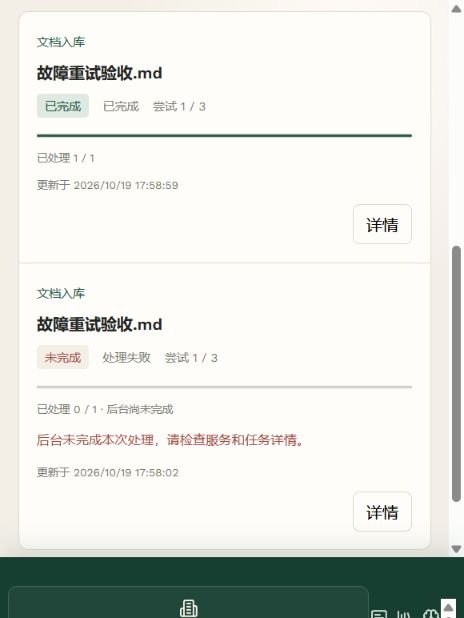

# 阶段六文档任务页中间验收

2026-10-19，当前工作区源码。仅覆盖统一任务页与重试链路，第六阶段尚未整体验收、提交、推送或部署业务环境。

## 实现与浏览器观察

- 资料页新增“后台任务”入口，持久入库模式下显示；列表按当前账号和当前空间读取，支持文件名、类型、状态及分页。
- 详情展示持久任务编号、阶段、尝试次数、时间和错误代码；不返回索引连接身份及内部任务元数据。
- 独立预览环境的入库 Embedding 替身按持久标记故意失败一次。真实持久队列产生失败任务 `366b59f2-db90-4783-8f76-181d940a710b`，错误代码 `UI_FIXTURE_FAILURE`。
- 从详情点击重试后，产生新任务 `25d7a2b1-4e9b-4599-bb26-ade24fda2fd0`；页面先显示等待处理，后台 Worker 完成后，打开的详情通过轮询更新为“已完成”。原失败回执继续保留，重试按钮消失。
- 输入“故障重试验收”后列表剩两条记录，分别为新任务成功及原任务失败。默认窄屏下卡片、详情操作可使用。
- 进度达到全部单位仍不直接标记成功：索引核验或文件清理结束前上限为 99%，最终成功状态才显示 100%。等待运行释放索引与等待自动重试分别说明。
- 重试提交提示改为“处理结果以任务状态为准”，避免成功后遗留“等待后台处理”的过时表述。

## 验证范围

后端专项覆盖任务过滤、分页、非法参数 422、文件名通配符转义、账号和空间权限、失败回执保留、重复重试幂等、旧失败任务不能覆盖后续退休操作、索引身份及活跃运行保护。HTTP 重复请求在新任务完成后仍返回同一条成功回执。

本轮后端任务、入库 Worker 与空间专项 **55 passed**；前端构建通过，Node 测试 **24 passed**。后端结果记录于忽略目录 `data/validation/stage6-task-workspace.xml`。这些是专项验证，不能替代整阶段回归与部署检查。

预览复用 [空间验收环境](stage6-workspace-ui.md) 的独立 PostgreSQL 数据库和虚构账号、资料。认证、API、队列、文件处理和版本核验为真实路径；向量和 Embedding 为本地替身，Worker 在预览进程中运行。以上不构成 Milvus、收费模型或独立 Worker 部署验收，也未更改业务数据。

## 截图

整组版本退休与父任务汇总、历史索引显式绑定、部署前检查和整阶段部署仍待完成。
