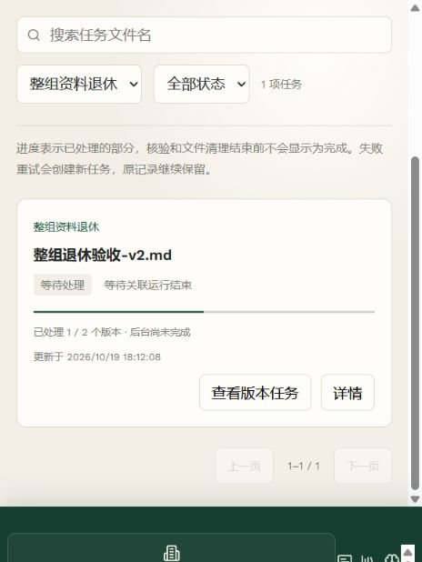
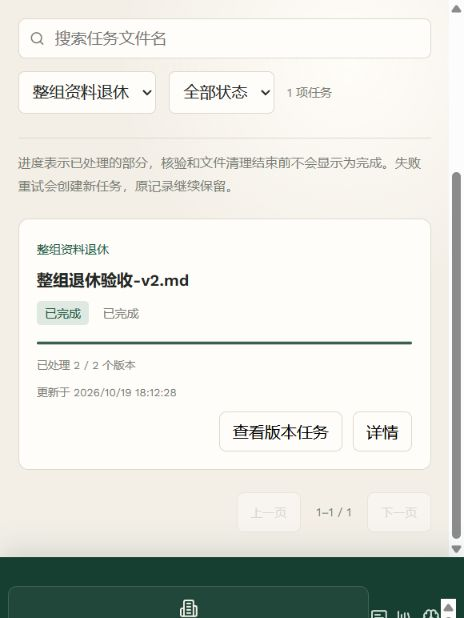

# 阶段六整组版本退休中间验收

2026-10-19，当前工作区源码。整组退休已实现并完成下述专项验证；第六阶段尚未完成部署验收，未提交或推送。

## 行为与契约

版本记录增加“退休整份资料”，确认说明包含全部版本、共享发布、后续物理清理及不能继续上传的范围。`POST /api/v2/documents/{id}/retire-series` 接收 `expected_version_count`，数量变化返回 409，要求刷新并重新确认；成功返回 202 和 `delete_series` 父任务。重复调用同一版本组返回原父任务。

服务端先锁定版本组和所有版本，核查账号、空间、各索引绑定，然后在同一事务中清空当前版本、撤下全部共享绑定、关闭版本组并创建逐版清理任务。任一索引未显式绑定或入队失败，事务整体回滚，不先撤销部分资料。已清理的历史版本计入完成数量，不重复清理；新资料可以独立上传，原版本组保持关闭。

逐版任务继续复用现有持久队列、租约和 fencing。活跃运行引用的版本等待释放，其他版本可以完成清理。父任务只汇总每个版本最新的执行回执；失败子任务单独重试并保留旧失败记录，完成数不会因重试重复累计。“查看版本任务”只列出该父任务的子记录，仍执行账号与空间权限检查。

新增迁移 `0008_series_retirement`：版本组记录退休任务，任务记录父任务关系并支持整组任务种类。拒绝通过降级抹除退休记录。业务数据库尚未升级；应随第六阶段部署门禁、备份和旧索引核验一起执行。

## 自动验证

- 任务、空间及入库 Worker 专项 **63 passed**，涵盖原子回滚、共享撤下、旧失败回执、已清理版本计数、活跃运行保护、父任务过滤权限、数量冲突与 HTTP 参数校验。
- PostgreSQL 迁移及并发集成 **23 passed**：空库与重复升级、已有数据保留、版本组锁冲突、关闭后拒绝追加版本、两个 Worker 同时清理后父任务正确累计为 2/2。
- 前端构建通过，Node 测试 **25 passed**。
- 当前后端全量 **528 passed、38 skipped、38 subtests passed**；跳过项不作已通过处理，迁移专项另按上述 PostgreSQL 实测结果记录。
- 浏览器暴露等待阶段在定时探测时短暂跳回“逐版清理”的问题；领取等待任务时保留等待阶段，专项测试覆盖探测期间父任务不误显示为清理。

## 浏览器及落盘结果

复用 [空间隔离预览环境](stage6-workspace-ui.md)，数据库迁移至 `0008_series_retirement`。新增两个虚构 Markdown 版本，V1 发布到专用共享库，并由一个测试等待运行引用。通过页面提交整组退休后，V2 先清理，父任务保持 1/2、等待关联运行结束。显式结束这个测试运行后，Worker 自动清理 V1，父任务变为 2/2；关联子任务均完成，共享库显示未发布资料。

数据库、向量替身和本地文件的 [最终检查结果](stage6-series-retirement-preview.json) 确认：两个版本均为 `retired`，索引均为 `cleaned`，源文件不存在，向量片段数及共享绑定数均为 0，版本组当前指针为空。

预览使用真实认证、PostgreSQL、文件处理和持久队列；向量与 Embedding 为本地替身，Worker 在预览进程内运行，未调用收费模型。以上不作为 Milvus 或独立 Worker 部署证明；业务文件和第五阶段真实 A/B 报告未更改。历史索引显式核验绑定、初始化入口兼容检查、部署前门禁及整阶段部署仍待完成。
