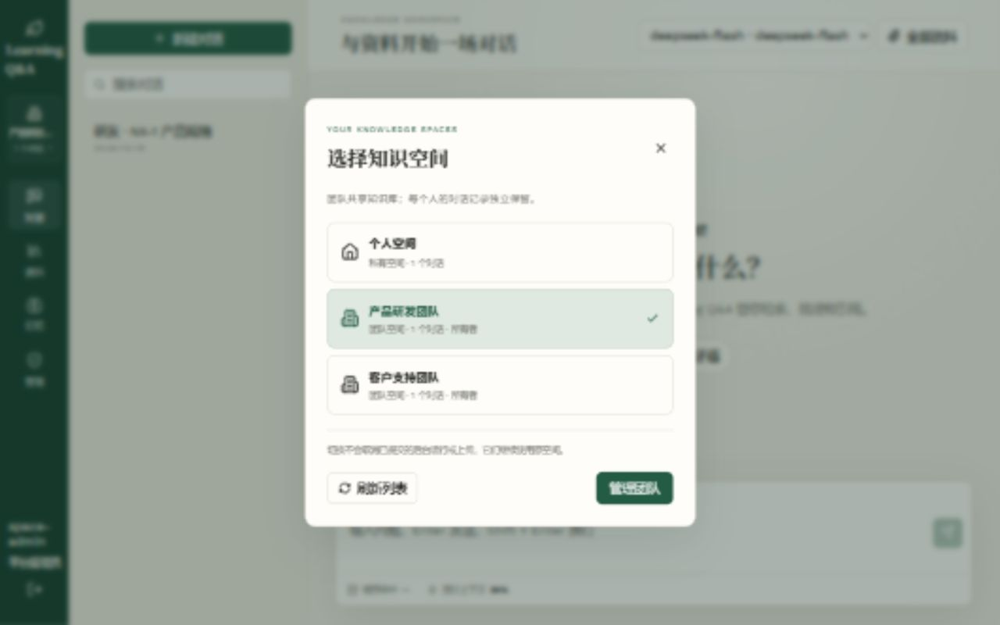
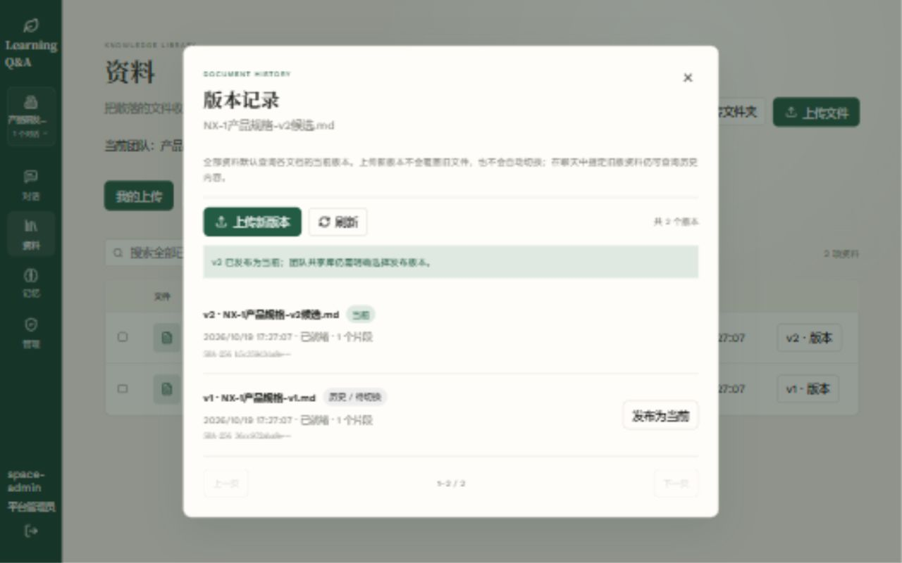
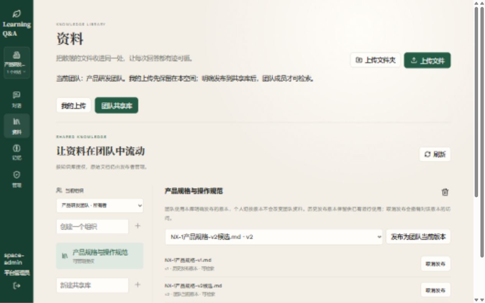
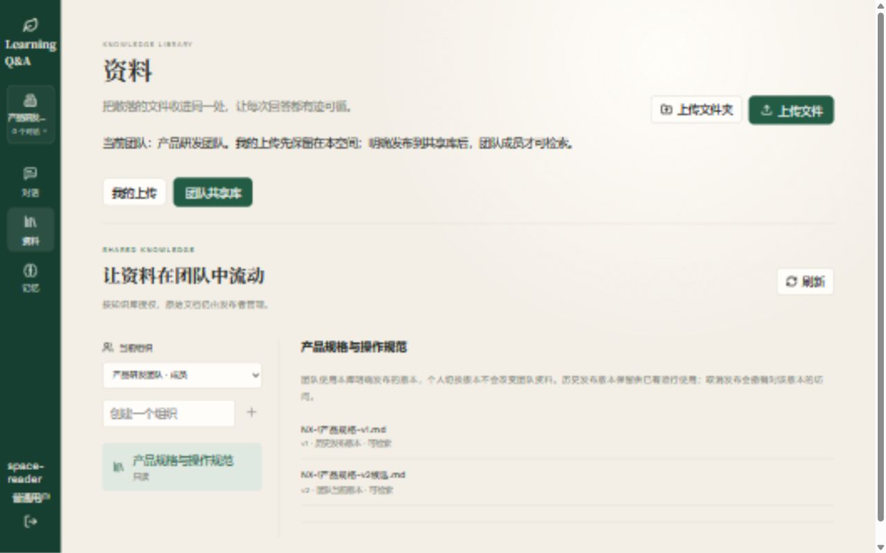

# 阶段六空间界面中间验收

2026-10-19。当前工作区源码，尚未阶段提交、推送或部署业务环境。本记录覆盖全局空间界面，不代替第六阶段整体验收。

## 环境与边界

- 入口：`http://127.0.0.1:8086`；独立 PostgreSQL 数据库 `parity_test_stage6_ui_5073c7f660cf`，迁移至 `0007_document_publication`。
- 两个虚构团队、管理员和只读成员、Markdown 测试资料。使用实际认证、成员/知识库 ACL、会话、上传、持久入库队列、版本核验/发布 API 与 Vue 构建产物。
- 入库 Worker 在预览进程内运行，向量与 Embedding 使用本地替身；模型连接指向本机关闭端口，未进行真实模型问答。本环境不作为独立 Worker 部署、Milvus、收费模型或 RAG 质量验收证据。
- 业务数据库、业务向量及第五阶段真实 A/B 历史报告未改写。页面中的资料均为虚构验收数据。

## 浏览器实测

| 路径 | 观察到的结果 |
|---|---|
| 管理员登录与空间列表 | 个人、产品研发、客户支持三项空间，分别显示该账号自己的会话数 |
| 团队切换 | 桌面会话列表从研发主题切为售后主题，没有混入个人会话 |
| 团队资料选择器 | 仅显示当前团队已授权共享库，不显示个人原始文档 |
| 刷新页面 | 认证恢复后保持原已授权团队，显示对应会话列表 |
| 核验后的候选 V2 | 版本对话框允许发布；发布后提示共享库需要另行明确选择版本 |
| 独立共享版本 | 原始资料当前已切到 V2 时，共享库仍为 V1；明确发布 V2 后，V1 显示历史、V2 显示团队当前 |
| 只读成员 | 仅有个人和产品研发团队，团队会话数为自己的 0；没有管理员导航或共享库发布、授权、删除按钮 |
| 实际上传 | 只读成员上传虚构 Markdown 原始资料后，任务显示原团队并完成入库；团队“我的上传”为 1，个人空间为 0 |
| 退出/切换账号 | 恢复管理员时读取其自己的已保存空间；上传队列重置的迟到回调另外由 Node 测试验证 |
| 断点与控制台 | 默认窄屏可打开原生空间对话框；临时桌面断点用于验证侧栏会话列表，之后重置覆盖；未捕获应用控制台错误 |

预览账户未尝试真实模型生成，以上界面成功不能用于宣称知识问答质量提升。第六阶段仍缺统一任务页、整组退休、旧索引显式核验绑定、部署前门禁与整阶段部署验收。

## 自动验证

- 前端构建通过；`npm run test:agents` **22 passed**，新增覆盖迟到列表/会话响应、旧 SSE、上传原空间归属、账号退出重置及撤权后停止进度读取。
- 后端全量 **517 passed、37 skipped、38 subtests passed**；独立 PostgreSQL 集成 **22 passed**。
- 预览启动暴露旧 Reranker 字段仍被关闭流程引用的问题，已修复检索器资源归属；冻结检索器在 Run 结束时关闭，分组检索不创建多余精排客户端，相关生命周期与容器关闭测试通过。

## 截图

