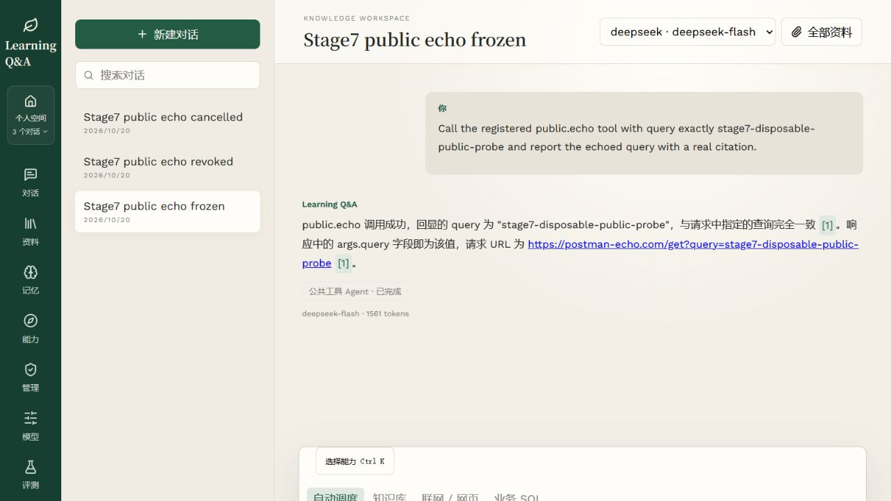
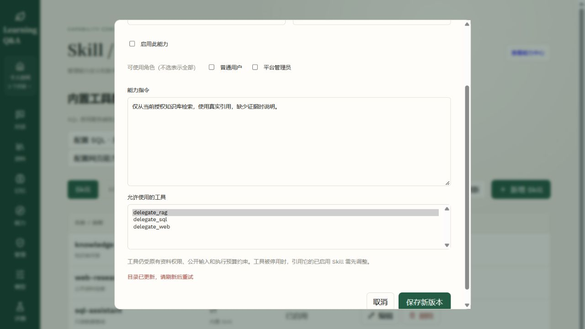

# 阶段七验收

2026-10-21。范围为能力注册与版本、Skill 装配、公共 HTTP Tool、SQL/Web 管理配置、能力中心与命令面板。审批执行、Sandbox 和完整追踪属于阶段八；本报告不宣称这些功能已经交付，也不改变第五阶段质量门禁失败的结论。

## 交付与证明

| 要求 | 实际验证 |
| --- | --- |
| 持久注册、版本、权限、依赖和并发 | 管理 API、角色过滤、历史、退休标识、CAS 和不可变快照专项；真实 PostgreSQL 空库/旧库升级与并发；Docker API 创建/更新/删除及普通账号 403 |
| HTTP Tool 执行边界 | 公共 HTTPS、固定 DNS、拒绝私网/跳转、对象 JSON Schema、Secret 名称、响应大小、超时/取消和凭据回显专项；非幂等结果未确认不重发 |
| 同 Run 冻结与接管 | 入队冻结目录与 Skill/Tool 版本；持久检查点复用成功回执；停用/角色/Secret/SQL 范围撤销后停止调用和发布；旧任务不自动补快照 |
| 独立 Worker 的真实调用 | 停止测试 Run Worker，目录修订 3 入队，再将 Skill/Tool 改至 v2 和新端点；重新启动独立容器后仍按原目录执行旧 GET 端点，得到真实公开 echo 响应和 Tool v1 引用 |
| 撤权与取消 | Docker 入队后停用 Skill，独立 Worker 记录 `CAPABILITY_SCOPE_CHANGED` 并终止；另一个冻结任务在排队时取消，保持 cancelled |
| SQL/Web 配置 | SQL 保存前实际核验独立只读连接与表；运行使用冻结策略并关闭专用客户端；真实临时业务库查询和截断通过，授予 UPDATE 后拒绝保存且修订不变；网页停用会撤销内置调用 |
| 界面与键盘 | 创建 Tool/Skill、编辑 v2、历史、Ctrl/Cmd+K 搜索/回车、激活后新会话、引用面板、普通账号限制、团队切换、窄屏；Docker 浏览器验证真实回答、旧表单冲突和停用入口 |
| 评测及 HITL | 评测任务冻结同一目录；公开 HTTP 的恢复输入独立于私人补充，保留同一 Run 与助手消息；原公开输入及恢复幂等专项通过 |
| 部署与历史数据 | 业务备份实际恢复验证后迁移至 0009，仅开启能力中心；API/前端和三个 Worker 就绪，旧源文件、绑定清单、个人归属及行数保持一致 |

界面早期证据见[隔离预览](stage7-capability-ui.md)，当时使用脚本上游；最终真实容器证据见 [Docker 验收](stage7-docker-acceptance.json)。实际运行使用 DeepSeek Flash 与公共 Postman Echo，5 次模型调用、4748 输入 token、305 输出 token，HTTP 工具调用一次；这是连通与版本验证，不代表企业问答质量。公开报告不包含 echo 的原始请求头或网络地址。

浏览器没有执行不可恢复删除的最终确认；删除事务、依赖拒绝和退休标识由真实 Docker HTTP/API 验证覆盖，管理表单的创建、更新、停用、并发失败由浏览器实际验证。没有将未执行的界面动作写为成功。

## 自动检查

最终完整后端为 **657 passed、48 skipped、38 subtests passed**；独立 PostgreSQL 迁移、目录并发及只读 SQL 管理组合 **31 passed**。跳过项需要各自的显式存储环境，未将跳过计作通过。前端 **32 项 Node 测试**及构建通过。Docker 构建的 npm 审计为 **0 vulnerabilities**；容器内 97 份 Python 源码与迁移文件逐份摘要匹配当前工作区。

离线完整回归、真实 PostgreSQL 迁移/目录并发/SQL 控制面输出分别保存于忽略目录 `data/validation/stage7-backend-final.xml` 与 `stage7-storage-final.xml`。真实数据库用例使用明确的临时测试库和只读角色，执行后移除；未在业务库创建测试账号或测试资料。

## 业务部署

[数据保留与预检证据](stage7-deployment.json)确认保留 1 个原账号、2 份文档、1478 个层级节点、3 个会话、6 条消息及 2 个模型配置历史。两份 PDF 的源哈希、原发布索引及 925 个叶子的绑定清单保持一致，没有重新嵌入或改写旧索引。

备份为忽略目录 `data/backups/20261020-223459-stage7`，实际恢复 `rag` 和 `public.alembic_version` 并校验 4 份源文件/缓存，临时恢复库已删除。只新增能力当前目录及历史表，初始化修订 1 和三个内置 Skill；本地配置仅更改 `CAPABILITY_CENTER_ENABLED`。没有重置密码或自动提升旧账号；业务管理端仍需通过既有邀请码注册管理员。Rerank 保持关闭。

恢复服务时 Docker 引擎曾未运行；启动已有 Docker Desktop 后保留原 Milvus 和数据卷，业务完整预检与 HTTP readiness 重新通过。隔离 PostgreSQL 的动态端口变化后，仅更新测试容器连接并重建容器，未重建镜像、删除数据库或改变业务连接。

本阶段验收后先提交推送，再进入阶段八。整个任务收尾时按构建前镜像清单清理本次生成且不再使用的镜像；保留最终部署镜像和已有数据库/数据卷，不执行全局 prune。

