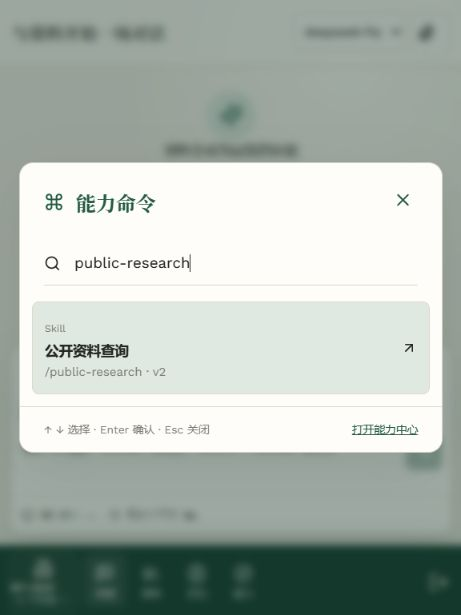
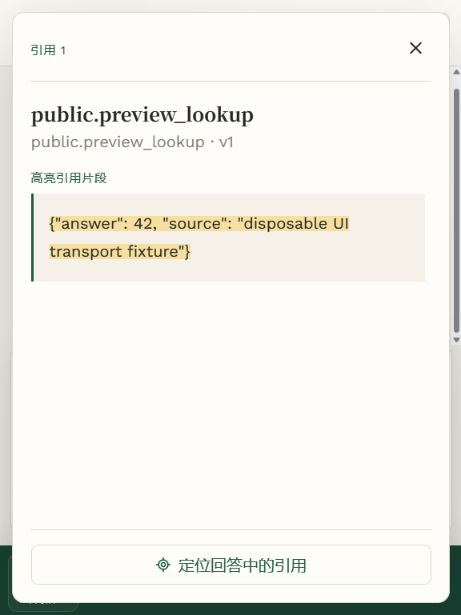
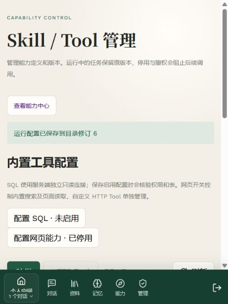

# 阶段七能力界面中间验收

2026-10-20。当前工作区源码，尚未完成阶段提交、推送或业务部署。本记录验证能力入口与管理流程，不代替整个第七阶段验收。

## 环境与结果

使用独立 `parity_test_stage7_ui_*` PostgreSQL 数据库，迁移至 `0009_capability_control`；实际 FastAPI 认证/权限/目录/Run API、Vue 构建产物与持久运行回执。两个虚构账号和一个虚构团队。预览入口 `http://127.0.0.1:8087`，Run Worker 在预览进程的线程内执行；模型与 HTTP 上游使用可观察替身，没有调用收费模型，不是独立 Worker/Milvus/真实外部 API 的部署验收。

| 流程 | 实际观察 |
| --- | --- |
| 管理员创建 Tool | 通过表单保存公共 HTTPS 地址、GET、对象参数 Schema，目录修订从 1 变为 2 |
| 创建 Skill | 通过原生多选工具白名单关联该 Tool，修订变为 3 |
| 编辑版本 | 编辑指令后 Skill 变为 v2，目录修订 4；历史保留创建和更新记录 |
| Ctrl+K 与回车 | 打开命令面板、搜索已注册 Skill、回车激活；跳转聊天后焦点进入输入框 |
| 实际运行 | 新建会话后仍保留已选 Skill，生成同一对用户/助手消息；Run 冻结目录修订 4、Skill v2、Tool v1，最终成功 |
| 工具引用 | 点击回答的真实引用按钮，面板显示注册工具名、v1 和测试响应片段 |
| 普通账号 | 没有平台管理导航与 Skill/Tool 编辑入口；直达管理页被重定向；独立 HTTP 检查 control-plane/versions 均为 403 |
| 空间切换 | 普通账号选择 Skill 后切到团队，旧选择被清空，目录重新读取 |
| 窄屏 | 修复页面未继承滚动容器和全局样式隐藏操作列的问题；导航、编辑、保存均可实际操作 |

数据库/HTTP 核对结果见 [结构化证据](stage7-capability-ui.json)。本轮未执行浏览器删除确认的最终动作；依赖保护、退休标识和删除事务由已有后端专项覆盖，后续整阶段验收仍需核查完整 CRUD 与冲突/错误路径。没有修改业务账号、资料、业务配置或第五阶段 A/B 报告。

前端构建及 **32 项 Node 测试**通过；新增覆盖真实目录搜索、不可用项键盘跳过、跨空间迟到响应、退出后的迟到错误，以及刷新后的选择撤销。本轮最后浏览器控制台未捕获 error 级消息。

SQL/Web 管理配置、包含 Skill 指令的上下文估算、整阶段真实服务/Docker/业务部署和其余验收仍待完成；当前不能将这些界面中间结果认定为第七阶段已完成。

## 运行配置补充验收

同一隔离预览更新后，管理员可进入 SQL/Web 配置。服务端没有 SQL 连接时明确显示未配置；保存未启用 SQL 的名称、白名单后目录变为修订 5。停用内置网页能力后变为修订 6，能力中心的 web-research 与 SQL Skill 均显示停用，激活按钮禁用，自定义公共 HTTP Skill 仍保持独立可用。原结构化 JSON 是修订 4 的历史快照，不将其冒充当前修订。未修改业务环境。

