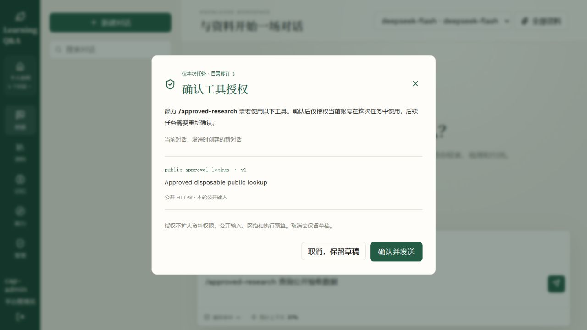
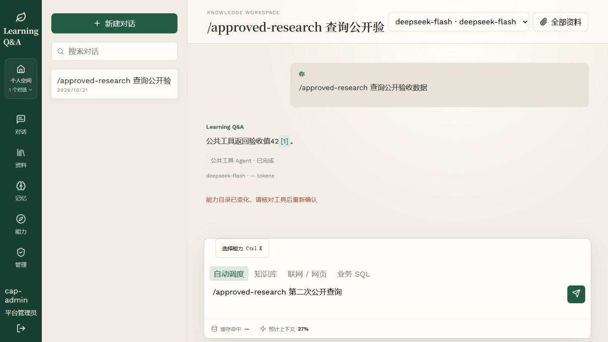

# 阶段八审批链路中间验收

2026-10-21。本记录只覆盖 Run 工具批准，不是整个阶段八完成证明。

## 范围与环境

独立临时 PostgreSQL、真实 FastAPI/Vue/Run 持久记录，模型和 HTTP 传输为脚本替身。预览 Worker 在线程内运行，不代替独立 Docker 或业务部署验收。没有启用业务环境的工具批准，也没有改写阶段七配置或第五阶段质量报告。

创建需审批的 `public.approval_lookup` v1 与关联 Skill 后，管理员可在发送前核对工具名、版本、目录修订、公开输入与资源范围。普通用户的该 Skill 不可用，管理控制面为 403。

| 场景 | 实际观察 |
| --- | --- |
| 初次发送 | 输入斜杠 Skill 后显示确认对话框，默认焦点在取消按钮；没有预先创建会话或 Run |
| 取消 | 草稿保留；独立 SQL 查询确认 Run 和消息均为 0 |
| 确认 | 创建一个会话、一个 Run 和两条消息，完成脚本上游调用并显示真实工具引用 |
| 冻结授权 | SQL 核验批准绑定实际 user/session/run、个人空间及目录摘要，保存工具名称和一次批准事件；Run 使用修订 3、Tool v1 |
| 再次发送 | 再次显示确认，没有复用第一次批准；取消后仍只有一个 Run |
| 目录并发变化 | 对话框显示修订 3 时，另一请求将 Tool 更新为 v2、目录 4；确认旧内容返回冲突，不创建 Run，草稿恢复 |
| 失败后重试 | 重新发送展示目录 4 和 Tool v2，取消仍保留草稿；原成功 Run 仍保留原批准和引用 |

[结构化 SQL/API 证据](stage8-approval-ui.json)记录环境边界和计数。截图是隔离预览，不含业务凭据或业务资料。

## 自动验证

审批/旧 Run/API/HTTP/冻结边界组合 **102 passed、8 subtests passed**；随后审批链路完整后端回归 **683 passed、48 skipped、38 subtests passed**（`data/validation/stage8-backend-approval.xml`），前端构建和 **35 项 Node 测试**通过。额外新增 Sandbox 纯契约后，Sandbox/批准组合 **33 passed**（包含 19 项 Sandbox 输入、镜像及资源约束；`stage8-contracts-current.xml`）。这些契约用例没有执行容器。

后端覆盖平台管理员要求、目录 CAS、批准范围、完整身份绑定、降权/停用/功能关闭、HITL 恢复、无批准工具不进入自动调用集合、驱动在网络前拒绝跨 Run 批准、审批事件、原幂等指纹及旧目录摘要。持久 Run Worker 配合脚本模型实际执行批准后的 HTTP 工具，保存原引用与回执。API/Worker 在批准关闭时保留原配置指纹，在开启时要求匹配新协议。

仍需完成 Sandbox 容器适配器、产物、完整追踪、真实容器和业务阶段八验收，以及其余键盘/空间切换组合。本阶段保持未提交，不进入阶段九。

